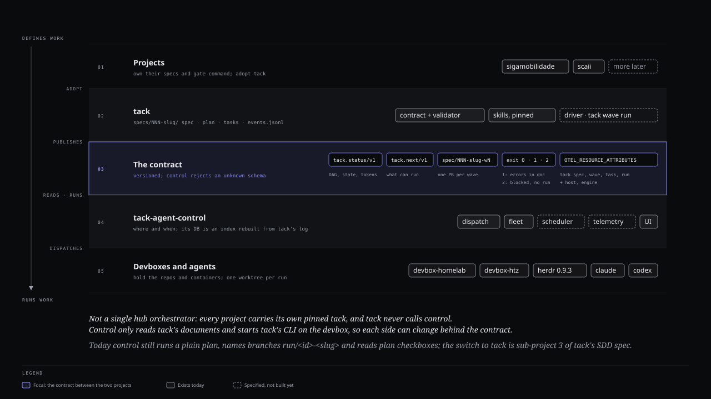
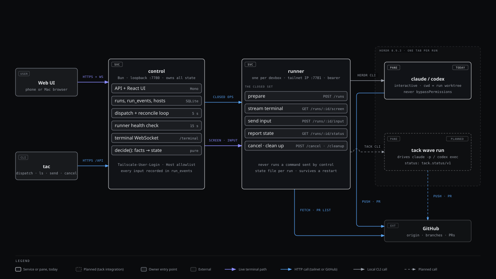
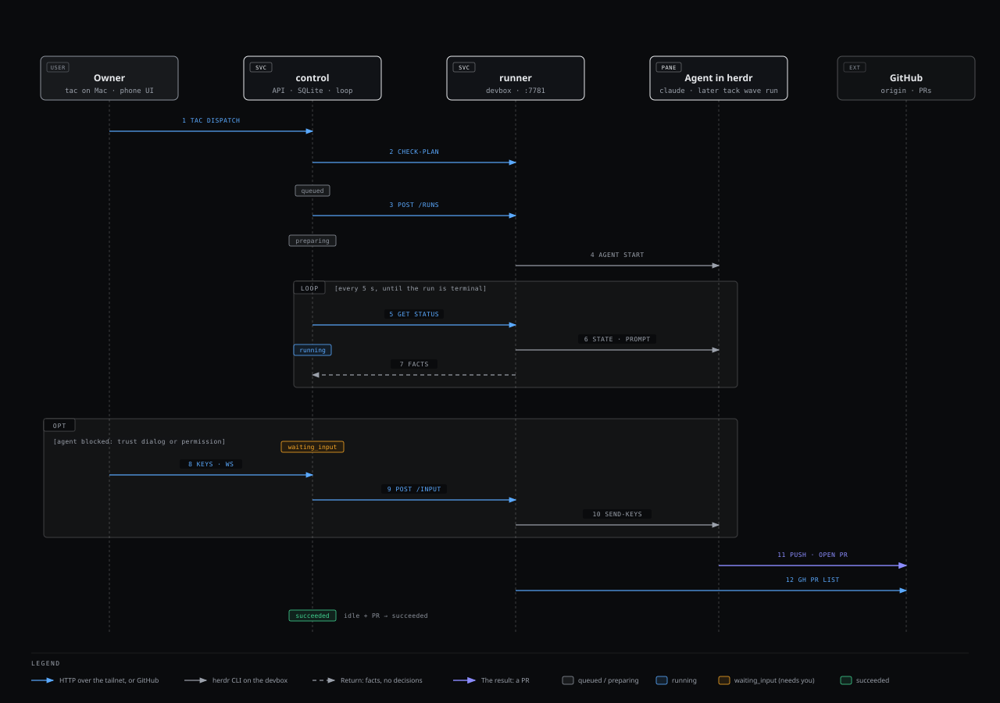
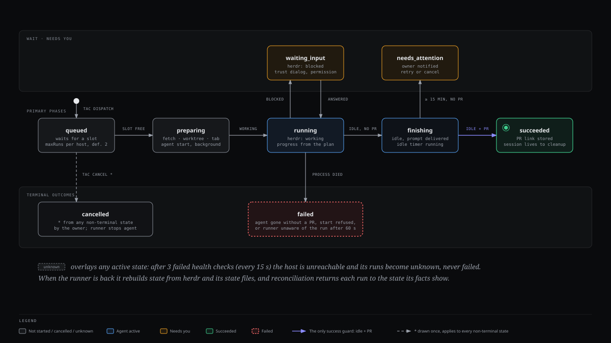
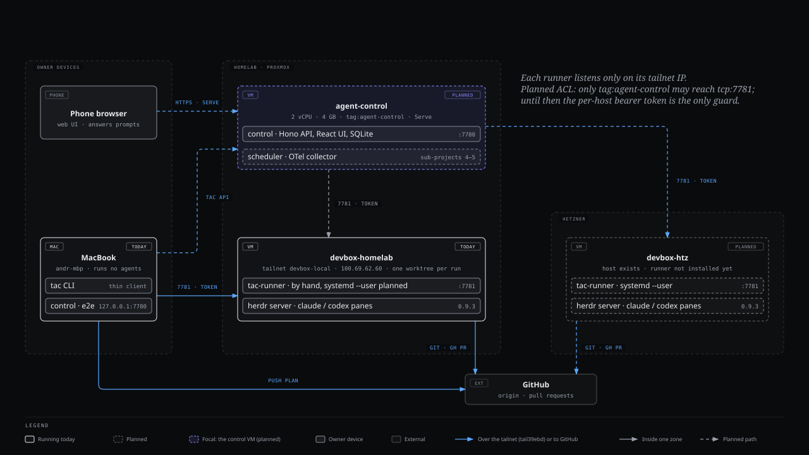

# tack-agent-control

**Write the plan anywhere. Run the agent on the devbox that holds the data. Watch and steer it from your phone.**

tack-agent-control is a small, single-owner control plane for coding agents. You push a
[superpowers](https://github.com/obra/superpowers) plan, `tac dispatch` sends it to the right devbox, and a real,
interactive `claude` or `codex` session executes it in its own git worktree inside herdr. You follow
the live terminal from a browser, answer the agent's questions, approve its permissions, and get a pull request at the
end. The laptop only defines work and reviews results; it runs no agent load.

<p align="center">
  
</p>

## Features

**Working today**

- **One-command dispatch.** `tac dispatch <project> <plan>` checks that the plan is pushed, picks the project's host
  and queues the run under a per-host concurrency limit.
- **Isolated runs.** Each run gets its own worktree (`~/worktrees/<project>/<run>`) on its own branch
  (`run/<id>-<plan-slug>`) and its own herdr tab.
- **Full interaction, phone included.** Live terminal over WebSocket; send text, answer questions and approve
  permissions. Runs never use `bypassPermissions`, and every input is recorded in `run_events`.
- **Verifiable outcomes.** Run state comes from facts, never from what the agent says: herdr process state, plan
  checkboxes, commits and an existing PR. A pure `decide()` maps those facts to one of ten states.
- **Survives restarts.** The runner keeps a state file per run and reloads it; control keeps state in SQLite and
  reconciles every run on start. An unreachable host turns its runs `unknown`, not `failed`.
- **Closed runner surface.** The runner exposes five operations (prepare, screen, input, status, cancel/cleanup) and
  never runs a command it was sent.
- **Tailnet only.** Control binds to loopback behind Tailscale Serve and trusts only the owner's Tailscale identity;
  each runner listens on its tailnet IP behind a bearer token.

**Planned**

- Full mobile-first web UI: fleet overview, run detail with wave and task progress, task DAG, permission prompts on
  the phone ([approved mockup](docs/design/ui-mockup/README.md)).
- Telemetry: OpenTelemetry from Claude Code and Codex, with tokens, wall time and failure rate. No dollars.
- Scheduler: delayed dispatch, cron runs, a queue with capacity limits per host and per account.
- `tack wave run` as a pane type, driven by tack's versioned status contract.

## How it works

<p align="center">
  
</p>

**Control decides, the runner only executes.** `control` owns all state and every decision. Each devbox runs one
`runner` that drives herdr. The highlighted path is the live terminal: browser WebSocket to control, control polls the
runner's screen.

<details>
<summary><b>One run, from <code>tac dispatch</code> to a pull request</b></summary>
<br>

</details>

<details>
<summary><b>Run states and the guards <code>decide()</code> applies</b></summary>
<br>


```
queued → preparing → running ⇄ waiting_input → finishing → succeeded
                        │                                 ↘ needs_attention
                        └→ cancelled / failed
unknown: the host is unreachable; resolved by reconciliation
```

- idle agent + PR found → `succeeded`
- idle with no PR for 15 minutes → `needs_attention`
- agent process died → `failed`
</details>

<details>
<summary><b>What runs where</b></summary>
<br>

</details>

## Packages

Bun workspace, TypeScript end to end (Bun, Hono, React, xterm.js, SQLite).

| Package | What it is |
|---|---|
| [`packages/shared`](packages/shared) | Run states and transitions, run IDs, branch names, plan progress parsing |
| [`packages/control`](packages/control) | API, React UI, SQLite store, dispatch and reconcile loop, `decide()` |
| [`packages/runner`](packages/runner) | Per-devbox daemon over git and herdr; compiled to a single `tac-runner` binary |
| [`packages/cli`](packages/cli) | The `tac` command line |

## Quickstart

```bash
bun install
bun test
bun run typecheck
```

Build the runner binary and the UI:

```bash
(cd packages/runner && bun run build) && (cd packages/control && bun run build:ui)
```

Deploy the runner to a devbox, start control and point the CLI at it: see the
[operations guide](docs/operations.md). Projects and hosts are declared in YAML
([`examples/projects.yaml`](examples/projects.yaml), [`examples/hosts.yaml`](examples/hosts.yaml)).

```text
tac dispatch <project> <plan-path> [--host auto|<host>] [--agent claude|codex]
tac ls [--all]
tac show <run>      tac screen <run>     tac send <run> <text...>
tac cancel <run>    tac retry <run>      tac cleanup <run>    tac open-pr <run>
```

## Docs

- [Design spec](docs/superpowers/specs/2026-10-15-tack-agent-control-design.md): intent, decisions, lifecycle, security
- [Operations guide](docs/operations.md): build, runner on a devbox, control behind Tailscale Serve
- [Diagrams](docs/diagrams/index.md): the HTML sources; regenerate the SVGs with `bun scripts/diagrams-to-svg.ts`
- [UI mockup](docs/design/ui-mockup/README.md): the approved console design

## Roadmap

| # | Sub-project | Status |
|---|---|---|
| 1 | Base: control VM, herdr and runner on the devboxes | Manual setup ([operations guide](docs/operations.md)); `infra` automation pending |
| 2 | Dispatcher and runner | Done |
| 3 | Web UI | Minimal run list and terminal today; full UI designed |
| 4 | Telemetry | Planned |
| 5 | Scheduler and queue | Planned; a per-host concurrency limit exists today |
